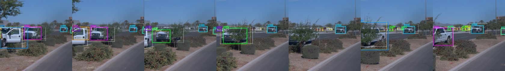
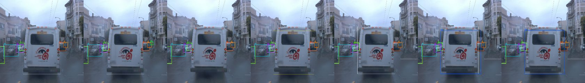
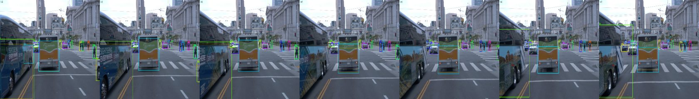

# Camera tracking baseline (Stage 4)

Status: current as of 2026-11-14. FRONT camera only. The main tables use seed 42; the ReID and LiDAR-gating comparison uses seeds 42, 43 and 44. Two detector checkpoints are scored in the main tables: YOLOv8n at
512 x 512 (`yolov8n-v1.2-s42`) and YOLOv8n at 640 x 960 trained on 100 segments (`yolov8n_hires_100-v1.2-s42`).

## Method

- **Detector:** YOLOv8n from the benchmark (protocol v1.3: setting S for the 512 detector, setting L for the 640 x 960 one). Detections are cached per frame in the
  run directory, so tracker settings can change without re-running the model.
- **Tracker:** `modules/tracking.py`, SORT-style. A constant-velocity Kalman filter per track over
  (cx, cy, w, h), Hungarian matching on IoU, matching only within a class. No appearance features.
- **Ground truth:** FRONT camera boxes with their persistent `camera_object_id`.
- **Scoring:** `scripts/track_eval.py` with `motmetrics`. A track matches a ground-truth box at
  IoU >= 0.5. Metrics are pooled per class across segments (identities never cross segments), and the
  headline MOTA and IDF1 weight each class by its number of ground-truth objects.
- **Evaluation data:** the same 10 frozen validation segments as the detection benchmark (1,967 frames).

## Checks on the pipeline

- **Identity oracle** (every ground-truth box gets its true id as a track) scores exactly 1.0 on every
  metric, so the scoring code is correct.
- **Box oracle** (ground-truth boxes as detections, through the tracker) scores MOTA 0.82 and IDF1 0.68.
  This is the ceiling of an IoU tracker on this data. Boxes of the same object overlap only about
  0.48 IoU (median) between consecutive frames on the segment checked, because many are small, and
  ground-truth labels disappear for up to 37 frames, longer than the default `max_age` of 5.

## Results (10 eval segments)

| Setup | MOTA | IDF1 | Vehicle recall / precision | Vehicle ID switches |
|---|---|---|---|---|
| YOLOv8n, default tracker (score 0.25, IoU 0.3, max_age 5, min_hits 2) | 0.105 | 0.286 | 0.31 / 0.64 | 516 |
| RT-DETR-L, same default tracker | -0.042 | 0.272 | 0.42 / 0.49 | 1,205 |
| **YOLOv8n, tuned tracker** (score 0.5, IoU 0.2, max_age 40, min_hits 1) | **0.166** | **0.307** | 0.28 / 0.79 | 328 |
| Box oracle (ceiling) | 0.819 | 0.679 | 0.90 / 1.00 | 1,616 |

Tuned settings were chosen on 3 held-out validation segments (`scripts/tune_tracker.py`, 144 settings,
about 590 frames, rule fixed in advance: best weighted IDF1, ties by MOTA) and then scored once on the
10 reported segments. On the dev segments the gain was IDF1 0.243 to 0.262 and MOTA 0.091 to 0.138, and the
top five settings were within 0.001 IDF1 of each other, so the optimum is flat.

### With the higher-resolution detector (YOLOv8n 640x960, 100 segments, run B)

Tracker settings were tuned again on the same 3 dev segments (score gate 0.25, IoU 0.2, max_age 20,
min_hits 3, chosen by the same IDF1 rule) and scored once on the 10 eval segments.

| Detector + tracker | MOTA | IDF1 | Vehicle recall / precision | Vehicle ID switches | Pedestrian / cyclist IDF1 |
|---|---|---|---|---|---|
| YOLOv8n 512, tuned | 0.166 | 0.307 | 0.28 / 0.79 | 328 | 0.17 / 0.00 |
| YOLOv8n 640x960 (B), default tracker | 0.054 | 0.322 | 0.42 / 0.55 | 761 | 0.22 / 0.20 |
| **YOLOv8n 640x960 (B), tuned** | 0.054 | **0.327** | 0.41 / 0.55 | 650 | 0.25 / 0.19 |

The better detector raises IDF1 (0.307 to 0.327) and lets the tracker follow pedestrians and cyclists
(this detector is the seed-42 run, the best of three seeds; seeds 43 and 44 reached mAP 0.108 and 0.122
with near-zero cyclist AP, so the cyclist tracking here should not be expected to repeat), but it adds false positives at the 0.25 gate, so MOTA falls (0.166 to 0.054). The selection rule was
fixed as IDF1 before tuning, so I kept it; the dev optimum was flat and a higher score gate would
likely recover MOTA, but picking it after seeing the eval numbers would be tuning on the reported set.

## HOTA

HOTA (`modules/hota.py`) follows the TrackEval definition: per class, mean over IoU thresholds 0.05 to 0.95 of
the geometric mean of detection accuracy (DetA) and association accuracy (AssA). It was written from that
definition and checked with analytic cases (identity gives 1.0; an id swap at the halfway point gives
AssA 0.5; no detections gives 0), but it was **not cross-checked against the reference TrackEval code**, which
could not be installed here. Existing MOTA and IDF1 are unchanged. Ground-truth-weighted, 10 evaluation segments:

| Detector and tracker | MOTA | IDF1 | HOTA | DetA | AssA |
|---|---|---|---|---|---|
| YOLOv8n 512 x 512, default tracker | 0.104 | 0.286 | 0.277 | 0.201 | 0.405 |
| YOLOv8n 512 x 512, tuned tracker | 0.166 | 0.307 | 0.287 | 0.187 | 0.461 |
| YOLOv8n 640 x 960 (L, seed 42), default tracker | 0.054 | 0.322 | 0.315 | 0.246 | 0.431 |
| YOLOv8n 640 x 960 (L, seed 42), tuned tracker | 0.054 | 0.327 | 0.314 | 0.241 | 0.440 |
| Box oracle (default tracker) | 0.819 | 0.679 | 0.650 | 0.770 | 0.550 |

Detection quality (DetA, 0.19 to 0.25) is the main limit, as in the failure analysis. The oracle's AssA of 0.55 is
the association ceiling of an IoU-only tracker on this data.

## Two further upgrades: appearance ReID and LiDAR 3-D gating

Both were tested under one fixed protocol on detections from all three YOLOv8n setting-L seeds (42, 43, 44):
each tracker's settings are tuned on 3 held-out validation segments (highest ground-truth-weighted IDF1, ties by
MOTA) and scored once on the 10 evaluation segments. Nothing was changed after seeing evaluation numbers.

- **ReID** (`modules/reid.py`): an ImageNet ResNet-18 embeds each detection crop (128 x 128, 10% padding). Tracks
  keep a moving average of their embeddings. Association blends cosine distance into the IoU cost, and a second
  stage re-links tracks that were lost for a few frames to unmatched detections by appearance inside a spatial gate.
- **LiDAR gating** (`modules/lidar_gate.py`): TOP-LiDAR points are projected into the camera, the central 60% of
  each box is used (ground points dropped, densest 2.5 m depth window kept) and the median point gives a 3-D
  position, moved to a world frame with the vehicle pose. Association is rejected (or penalised) when the
  ground-plane distance to the track's predicted position is too large.

Means over the three seeds (per-seed values in the repository's result files):

| Tracker | IDF1 | HOTA | AssA | MOTA | ID switches | ID switches after a gap |
|---|---|---|---|---|---|---|
| Baseline (tuned) | 0.350 | 0.326 | 0.451 | 0.163 | 636 | 384 |
| + ReID | 0.359 | 0.332 | 0.464 | 0.137 | 574 | 352 |
| + LiDAR gating | 0.349 | 0.326 | 0.454 | 0.165 | 587 | n/a |
| + ReID + LiDAR gating | 0.353 | 0.328 | 0.455 | 0.134 | 697 | n/a |

Difference against the baseline, by seed (42 / 43 / 44):

| | IDF1 | HOTA | AssA | MOTA |
|---|---|---|---|---|
| + ReID | +0.004 / +0.004 / +0.020 | +0.000 / +0.003 / +0.013 | +0.001 / +0.007 / +0.030 | -0.063 / +0.002 / -0.017 |
| + LiDAR gating | 0.000 / -0.004 / +0.003 | 0.000 / -0.003 / +0.002 | 0.000 / -0.005 / +0.014 | 0.000 / -0.001 / +0.007 |
| + ReID + LiDAR gating | -0.002 / +0.004 / +0.008 | -0.002 / +0.003 / +0.006 | -0.007 / +0.007 / +0.011 | -0.067 / +0.002 / -0.022 |

**Reading**
- **ReID helps a little and consistently in direction.** IDF1, HOTA and AssA improve on all three seeds (mean
  +0.009, +0.005 and +0.012), and vehicle ID switches after a gap fall on all three seeds (by 3 to 16%; all-class switches after a gap fall from 384 to 352 on average). The gain is small next
  to the seed-to-seed spread, two of three seeds gain only about +0.004 IDF1, and seed 44 dominates. The gains on the
  tuning segments were larger than on the evaluation segments, so some of the advantage is selection noise from tuning
  on only 3 segments. MOTA falls on two seeds because the tuning rule picks settings that add false tracks.
  Detection accuracy (DetA) does not change, as expected. A plain tracker with the same longer memory (`max_age`
  up to 80) chose exactly the baseline settings, so longer memory explains none of the gain.
- **Why ReID is weak here:** the detections are small (median missed box 22 to 28 px), so ImageNet features of tiny crops carry
  little identity information. A trained ReID head or larger crops are the obvious next step.
- **LiDAR gating does not help.** Its mean IDF1 (0.349) equals the baseline (0.350), differences are within -0.004 to
  +0.003, and the tuning rule often switched the gate off. Combining it with ReID is no better than ReID alone.
- **Why the gate does not help:**
  - **Coverage:** where objects get confused (small, distant detections) there is often no usable 3-D estimate. Only
    3 to 6% of small vehicle detections get one, against 51 to 55% of medium and 98 to 99% of large ones.
  - **Resolution:** the vehicle estimate is coarse for gating. Against the LiDAR boxes, 97.5% of vehicles get an estimate with
    a median ground-plane error of 2.2 m (the points sit on the visible surface, not the box centre), a 1.2 m spread and
    a 9.7 m 90th-percentile error from wrong-cluster picks. Pedestrians and cyclists are much better (median about 0.1 m).
  - **Cause of switches:** most switches follow gaps in detection, which depth consistency cannot fix.
- **Caveats:** only 3 seeds and 3 tuning segments, no significance test, YOLOv8n detections only (RT-DETR-L was not tried),
  ground-plane distance only, and the same rolling-shutter approximation as the fusion code.

## Failure replay (YOLOv8n 640x960, run B, tuned tracker)

`scripts/track_replay.py` re-runs the tracker on the cached detections, matches tracks to ground truth
frame by frame (IoU >= 0.5, keeping the previous pairing when possible) and gives every missed
ground-truth box a cause. It also writes image strips (3 frames before and after an event, white = ground
truth, thick coloured = tracks with ids, thin yellow = detections) under `runs/<run>/tracking/replay/`.

| Class | Ground-truth boxes | Missed | Detector miss | Association miss | ID switches (after a gap) | Fragmentations |
|---|---|---|---|---|---|---|
| Vehicle | 26,142 | 15,377 (59%) | 13,884 (90%) | 1,493 (10%) | 653 (421) | 822 |
| Pedestrian | 6,901 | 5,813 (84%) | 5,612 (97%) | 201 (3%) | 16 (15) | 77 |
| Cyclist | 453 | 328 (72%) | 310 (95%) | 18 (5%) | 6 (5) | 6 |

524 tracks last fewer than 5 frames. A detector miss means no detection overlaps the box at IoU 0.5;
an association miss means a detection above the score gate overlaps it but no track covers it. The "below
the gate" cause is always 0 here because the cached detections already start at the 0.25 gate.

What the strips show:

- **Missing objects are almost all detector misses** (90 to 97%), and they are small: the median
  missed box is 22 to 28 px on a side (vehicle 28, pedestrian 22, cyclist 22). Association is not the main loss.
- **Association misses are larger boxes** (median side 40 to 53 px). In the strips reviewed, some are track
  start-up lag: a new object is detected but gets no output for the first `min_hits` frames. The share
  caused by this has not been counted.
- **Most ID switches (421 of 653 vehicle) happen after a gap**, when an object is lost for a few frames
  (occlusion, or a detector miss) and then picked up by a new track. Swaps between two touching objects are rarer.

This agrees with the box-oracle check: the tracker is limited by detection first and by gaps second. The
two cheap levers left are a shorter confirmation delay for confident, large detections and appearance
features to re-link tracks across gaps (the deferred ReID item).

### Examples

Each strip shows seven consecutive FRONT-camera frames (t-3 to t+3) cropped around the event. White is
ground truth, thick coloured boxes with `#id` are tracker output, thin yellow boxes are raw detections.



*ID switch after a gap:* a vehicle is lost for several frames and comes back under a new track id.



*Association miss from start-up lag:* the bus is detected from the first frame (thin yellow), but the
tracker only outputs a track two frames later (thick blue), so those frames count as misses.



*Detector miss:* a large bus passing close on the left, cut by the image edge, has a ground-truth box but no
detection and no track, while the smaller vehicles and pedestrians ahead are tracked.

Frames are from the Waymo Open Dataset (validation split) and are shown under the terms of the
[Waymo Open Dataset license](https://waymo.com/open/terms).

## What this shows

1. **Detection is the main limit.** Even the tuned tracker loses most objects: vehicle recall is 0.28,
   cyclists are never tracked, and pedestrians stay at IDF1 0.17.
2. **Most of the gain came from the stricter score gate** (fewer false tracks), plus a longer track
   memory that reduces vehicle ID switches (516 to 328). Pedestrian switches rose (25 to 55) with the
   longer memory.
3. **A better detector alone does not fix tracking.** RT-DETR-L finds more objects but adds false
   positives at the same gate and switches identities more often. With a higher score gate it
   slightly beats YOLOv8n (IDF1 0.333 vs 0.289 at gate 0.6), but that sweep used the eval segments
   and is a sensitivity check only, not a result.
4. **The IoU tracker has a low ceiling.** With perfect boxes IDF1 is 0.68, so association needs
   appearance or motion cues for the remaining gap.

## Limits

3 tuning segments; only the FRONT camera; the main tables use one detector seed per detector (the ReID and LiDAR-gating
comparison uses three); HOTA is not cross-checked against the reference TrackEval code; the tuned-tracker gain over
the default is about +0.02 IDF1 and was not repeated on other seeds.

## Reproduce

```bash
python scripts/track_eval.py --config configs/yolov8n.yaml --run-dir runs/yolov8n-v1.2-s42
python scripts/tune_tracker.py --config configs/yolov8n.yaml --run-dir runs/yolov8n-v1.2-s42
python scripts/track_eval.py --config configs/yolov8n.yaml --run-dir runs/yolov8n-v1.2-s42 \
    --score-thresh 0.5 --iou-threshold 0.2 --max-age 40 --min-hits 1 --out runs/yolov8n-v1.2-s42/tracking/tracking_tuned.json
```

The 640 x 960 results use the same scripts with the hi-res config and run directory:

```bash
python scripts/track_eval.py --config configs/yolov8n_hires_100.yaml --run-dir runs/yolov8n_hires_100-v1.2-s42 \
    --score-thresh 0.25 --iou-threshold 0.2 --max-age 20 --min-hits 3 --out runs/yolov8n_hires_100-v1.2-s42/tracking/tracking_tuned.json
```

The ReID and LiDAR-gating comparisons (they reuse the cached detections of each run; the LiDAR one first needs the
tuning and evaluation segments' LiDAR and poses, which `prepare_gate_data.py` fetches and decodes):

```bash
RUNS="runs/yolov8n_hires_100-v1.2-s42 runs/yolov8n_hires_100-v1.2-s43 runs/yolov8n_hires_100-v1.2-s44"
python scripts/reid_experiment.py --config configs/yolov8n_hires_100.yaml --run-dirs $RUNS
python scripts/prepare_gate_data.py
python scripts/lidar_gate_experiment.py --config configs/yolov8n_hires_100.yaml --run-dirs $RUNS
python scripts/lidar_gate_check.py          # accuracy of the 3-D estimates against LiDAR ground truth
```

Failure replay (needs the cached detections from the first command, and the tuning file from the second):

```bash
python scripts/track_replay.py --config configs/yolov8n_hires_100.yaml --run-dir runs/yolov8n_hires_100-v1.2-s42
```
