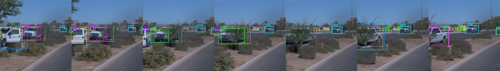
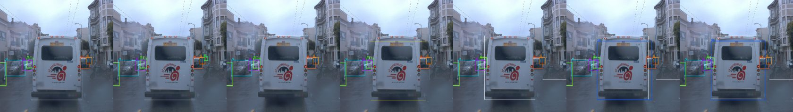
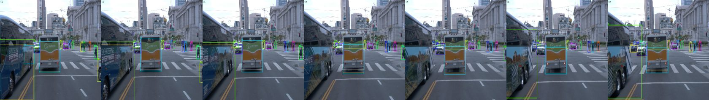

# Camera tracking baseline (Stage 4)

Status: current as of 2026-11-03. Seed 42 only, FRONT camera only. Two detector checkpoints are scored: YOLOv8n at
512 x 512 (`yolov8n-v1.2-s42`) and YOLOv8n at 640 x 960 trained on 100 segments (`yolov8n_hires_100-v1.2-s42`).

## Method

- **Detector:** YOLOv8n from the benchmark (protocol v1.2). Detections are cached per frame in the
  run directory, so tracker settings can change without re-running the model.
- **Tracker:** `modules/tracking.py`, SORT-style. A constant-velocity Kalman filter per track over
  (cx, cy, w, h), Hungarian matching on IoU, matching only within a class. No appearance features.
- **Ground truth:** FRONT camera boxes with their persistent `camera_object_id`.
- **Scoring:** `scripts/track_eval.py` with `motmetrics`. A track matches a ground-truth box at
  IoU >= 0.5. Metrics are pooled per class across segments (identities never cross segments), and the
  headline MOTA and IDF1 weight each class by its number of ground-truth objects.
- **Evaluation data:** the same 10 frozen validation segments as the detection benchmark (1,967 frames).

## Checks on the pipeline

- **Identity oracle** (every ground-truth box gets its true id as a track) scores exactly 1.0 on every
  metric, so the scoring code is correct.
- **Box oracle** (ground-truth boxes as detections, through the tracker) scores MOTA 0.82 and IDF1 0.68.
  This is the ceiling of an IoU tracker on this data. Boxes of the same object overlap only about
  0.48 IoU (median) between consecutive frames on the segment checked, because many are small, and
  ground-truth labels disappear for up to 37 frames, longer than the default `max_age` of 5.

## Results (10 eval segments)

| Setup | MOTA | IDF1 | Vehicle recall / precision | Vehicle ID switches |
|---|---|---|---|---|
| YOLOv8n, default tracker (score 0.25, IoU 0.3, max_age 5, min_hits 2) | 0.105 | 0.286 | 0.31 / 0.64 | 516 |
| RT-DETR-L, same default tracker | -0.042 | 0.272 | 0.42 / 0.49 | 1,205 |
| **YOLOv8n, tuned tracker** (score 0.5, IoU 0.2, max_age 40, min_hits 1) | **0.166** | **0.307** | 0.28 / 0.79 | 328 |
| Box oracle (ceiling) | 0.819 | 0.679 | 0.90 / 1.00 | 1,616 |

Tuned settings were chosen on 3 held-out validation segments (`scripts/tune_tracker.py`, 144 settings,
about 590 frames, rule fixed in advance: best weighted IDF1, ties by MOTA) and then scored once on the
10 reported segments. On the dev segments the gain was IDF1 0.243 to 0.262 and MOTA 0.091 to 0.138, and the
top five settings were within 0.001 IDF1 of each other, so the optimum is flat.

### With the higher-resolution detector (YOLOv8n 640x960, 100 segments, run B)

Tracker settings were tuned again on the same 3 dev segments (score gate 0.25, IoU 0.2, max_age 20,
min_hits 3, chosen by the same IDF1 rule) and scored once on the 10 eval segments.

| Detector + tracker | MOTA | IDF1 | Vehicle recall / precision | Vehicle ID switches | Pedestrian / cyclist IDF1 |
|---|---|---|---|---|---|
| YOLOv8n 512, tuned | 0.166 | 0.307 | 0.28 / 0.79 | 328 | 0.17 / 0.00 |
| YOLOv8n 640x960 (B), default tracker | 0.054 | 0.322 | 0.42 / 0.55 | 761 | 0.22 / 0.20 |
| **YOLOv8n 640x960 (B), tuned** | 0.054 | **0.327** | 0.41 / 0.55 | 650 | 0.25 / 0.19 |

The better detector raises IDF1 (0.307 to 0.327) and lets the tracker follow pedestrians and cyclists
(this detector is the seed-42 run, the best of three seeds; seeds 43 and 44 reached mAP 0.108 and 0.122
with near-zero cyclist AP, so the cyclist tracking here should not be expected to repeat), but it adds false positives at the 0.25 gate, so MOTA falls (0.166 to 0.054). The selection rule was
fixed as IDF1 before tuning, so I kept it; the dev optimum was flat and a higher score gate would
likely recover MOTA, but picking it after seeing the eval numbers would be tuning on the reported set.

## Failure replay (YOLOv8n 640x960, run B, tuned tracker)

`scripts/track_replay.py` re-runs the tracker on the cached detections, matches tracks to ground truth
frame by frame (IoU >= 0.5, keeping the previous pairing when possible) and gives every missed
ground-truth box a cause. It also writes image strips (3 frames before and after an event, white = ground
truth, thick coloured = tracks with ids, thin yellow = detections) under `runs/<run>/tracking/replay/`.

| Class | Ground-truth boxes | Missed | Detector miss | Association miss | ID switches (after a gap) | Fragmentations |
|---|---|---|---|---|---|---|
| Vehicle | 26,142 | 15,377 (59%) | 13,884 (90%) | 1,493 (10%) | 653 (421) | 822 |
| Pedestrian | 6,901 | 5,813 (84%) | 5,612 (97%) | 201 (3%) | 16 (15) | 77 |
| Cyclist | 453 | 328 (72%) | 310 (95%) | 18 (5%) | 6 (5) | 6 |

524 tracks last fewer than 5 frames. A detector miss means no detection overlaps the box at IoU 0.5;
an association miss means a detection above the score gate overlaps it but no track covers it. The "below
the gate" cause is always 0 here because the cached detections already start at the 0.25 gate.

What the strips show:

- **Missing objects are almost all detector misses** (90 to 97%), and they are small: the median
  missed box is 22 to 28 px on a side (vehicle 28, pedestrian 22, cyclist 22). Association is not the main loss.
- **Association misses are larger boxes** (median side 40 to 53 px). In the strips reviewed, some are track
  start-up lag: a new object is detected but gets no output for the first `min_hits` frames. The share
  caused by this has not been counted.
- **Most ID switches (421 of 653 vehicle) happen after a gap**, when an object is lost for a few frames
  (occlusion, or a detector miss) and then picked up by a new track. Swaps between two touching objects are rarer.

This agrees with the box-oracle check: the tracker is limited by detection first and by gaps second. The
two cheap levers left are a shorter confirmation delay for confident, large detections and appearance
features to re-link tracks across gaps (the deferred ReID item).

### Examples

Each strip shows seven consecutive FRONT-camera frames (t-3 to t+3) cropped around the event. White is
ground truth, thick coloured boxes with `#id` are tracker output, thin yellow boxes are raw detections.



*ID switch after a gap:* a vehicle is lost for several frames and comes back under a new track id.



*Association miss from start-up lag:* the bus is detected from the first frame (thin yellow), but the
tracker only outputs a track two frames later (thick blue), so those frames count as misses.



*Detector miss:* a large bus passing close on the left, cut by the image edge, has a ground-truth box but no
detection and no track, while the smaller vehicles and pedestrians ahead are tracked.

Frames are from the Waymo Open Dataset (validation split) and are shown under the terms of the
[Waymo Open Dataset license](https://waymo.com/open/terms).

## What this shows

1. **Detection is the main limit.** Even the tuned tracker loses most objects: vehicle recall is 0.28,
   cyclists are never tracked, and pedestrians stay at IDF1 0.17.
2. **Most of the gain came from the stricter score gate** (fewer false tracks), plus a longer track
   memory that reduces vehicle ID switches (516 to 328). Pedestrian switches rose (25 to 55) with the
   longer memory.
3. **A better detector alone does not fix tracking.** RT-DETR-L finds more objects but adds false
   positives at the same gate and switches identities more often. With a higher score gate it
   slightly beats YOLOv8n (IDF1 0.333 vs 0.289 at gate 0.6), but that sweep used the eval segments
   and is a sensitivity check only, not a result.
4. **The IoU tracker has a low ceiling.** With perfect boxes IDF1 is 0.68, so association needs
   appearance or motion cues for the remaining gap.

## Limits

Single seed and detector checkpoint; 3 tuning segments; only the FRONT camera; no HOTA (not in
`motmetrics`); the tracker was scored on one detector seed per detector; the +0.02 IDF1 gain is within what a second seed could change and has not been repeated.

## Reproduce

```bash
python scripts/track_eval.py --config configs/yolov8n.yaml --run-dir runs/yolov8n-v1.2-s42
python scripts/tune_tracker.py --config configs/yolov8n.yaml --run-dir runs/yolov8n-v1.2-s42
python scripts/track_eval.py --config configs/yolov8n.yaml --run-dir runs/yolov8n-v1.2-s42 \
    --score-thresh 0.5 --iou-threshold 0.2 --max-age 40 --min-hits 1 --out runs/yolov8n-v1.2-s42/tracking/tracking_tuned.json
```

The 640 x 960 results use the same scripts with the hi-res config and run directory:

```bash
python scripts/track_eval.py --config configs/yolov8n_hires_100.yaml --run-dir runs/yolov8n_hires_100-v1.2-s42 \
    --score-thresh 0.25 --iou-threshold 0.2 --max-age 20 --min-hits 3 --out runs/yolov8n_hires_100-v1.2-s42/tracking/tracking_tuned.json
```

Failure replay (needs the cached detections from the first command, and the tuning file from the second):

```bash
python scripts/track_replay.py --config configs/yolov8n_hires_100.yaml --run-dir runs/yolov8n_hires_100-v1.2-s42
```
